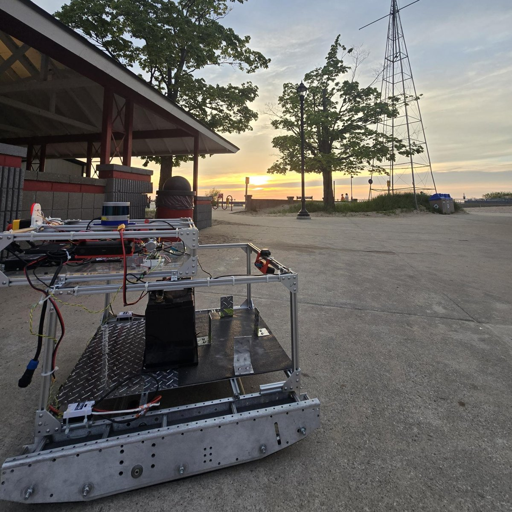

# Ryan Simpson

CS @ Cal Poly Pomona, class of 2028. I build simulation and autonomy software for ground robots.

Right now that means digital twins, ROS 2, and sim-to-real testing. Next up: planning. Exploration, frontier, and motion planning.

MARVIN, our tracked IGVC rover. I'm building his digital twin.

## What I'm building

**[ASL Autonomy Sim](https://github.com/Ryan-Simpson/AVL_Autonomy_Sim)** · ROS 2 Humble · Gazebo Fortress · C++ · Docker 
A digital twin of MARVIN, our lab's 49 kg tracked IGVC rover. It uses the real robot's topic names, so the lab's autonomy stack runs in sim with no changes. First full autonomous lap: 136 m, 41 of 48 waypoints, zero barrels hit. I lead the team.

**[Sim Chair Teleop](https://github.com/Ryan-Simpson/SimChair_AVL)** · WebRTC · UDP · Tailscale · Jetson AGX Orin 
Drive the lab's go-kart from a D-BOX motion chair and a racing wheel. Three live camera feeds plus motion cues, all over cellular. Held up for a 90-minute outdoor run on all three cameras. Presented at the CARS symposium. Led a team of five.

**[VLP-16 Decoder](https://github.com/Ryan-Simpson/velodyne-vlp16-decoder)** · Python · Open3D 
Real-time decoder and 3D viewer for raw Velodyne VLP-16 packets. 300k+ points/sec at 15 FPS. The first stage of the lab's LiDAR pipeline.

**[LeWitt-LiDAR](https://github.com/Ryan-Simpson/lewitt-lidar)** · Python · Open3D 
Live LiDAR scans turned into generative art using Sol LeWitt's wall drawing rules. Robotics meets art history.

**[CaseBridge](https://github.com/Ryan-Simpson/CaseBridge)** · React · Claude API 
AI co-pilot that cuts paperwork for social workers. 3rd place at the CPP AI Hackathon 2026.

## Also

- **SLAM:** RTAB-Map on the ASL go-kart, fusing VLP-16, ZED X, and Xsens IMU on a Jetson AGX Orin. Built with [Changwe Musonda](https://github.com/changwemusonda/avl_slam).
- **UAV search and rescue:** frontier planning research at the CPP UAV Lab.
- **NGCP:** autonomy team for a rescue-mission ground vehicle (RF homing and path planning) with the [Northrop Grumman Collaboration Project](https://github.com/ngcp-project).
- **ProCSI-C 2026:** multibody simulation with PyChrono at UW-Madison's Simulation-Based Engineering Lab.

## Toolbox

**Use most:** Python · ROS 2 · Gazebo · Linux · Git 
**Going deeper:** modern C++ (STL, RAII, CMake) · Docker · Nav2 · Isaac Sim 
**Hardware:** Jetson AGX Orin · Velodyne VLP-16 · Stereolabs ZED X · Xsens MTi · ESP32 · Arduino

## Find me

[LinkedIn](https://www.linkedin.com/in/ryan-m-simpson) · [ASL](https://autovehiclelab.com) · [Linktree](https://linktr.ee/RyanMSimpson)

Looking for summer 2027 internships in robotics software and simulation.
